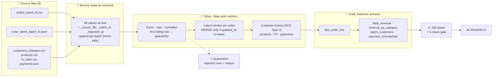
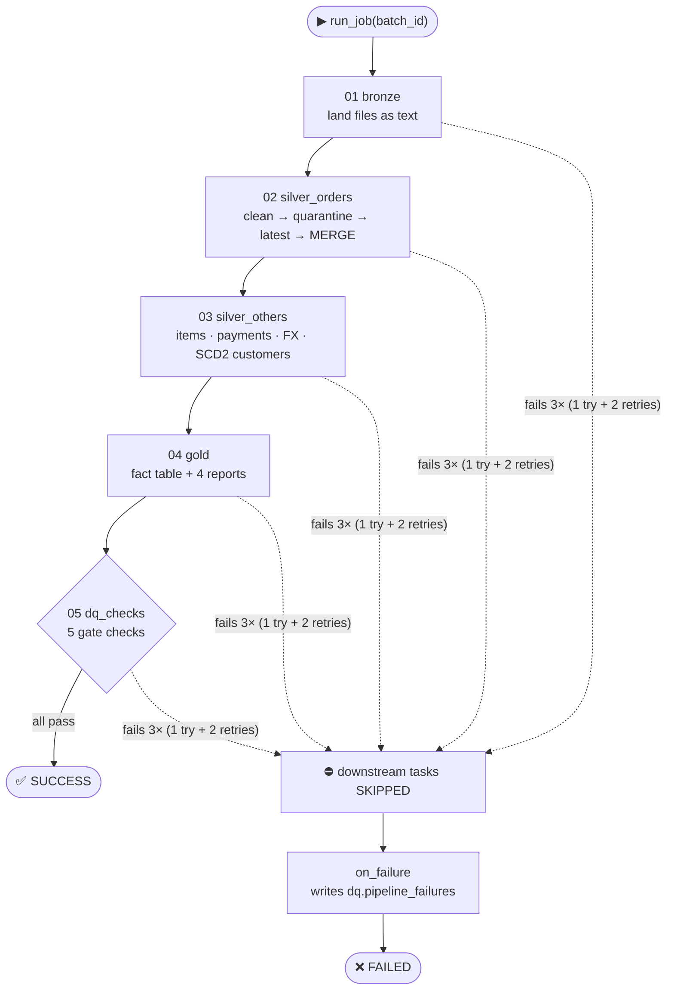
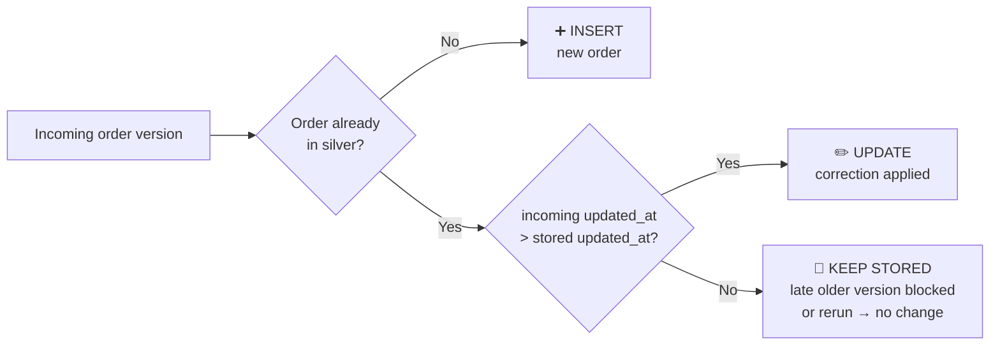
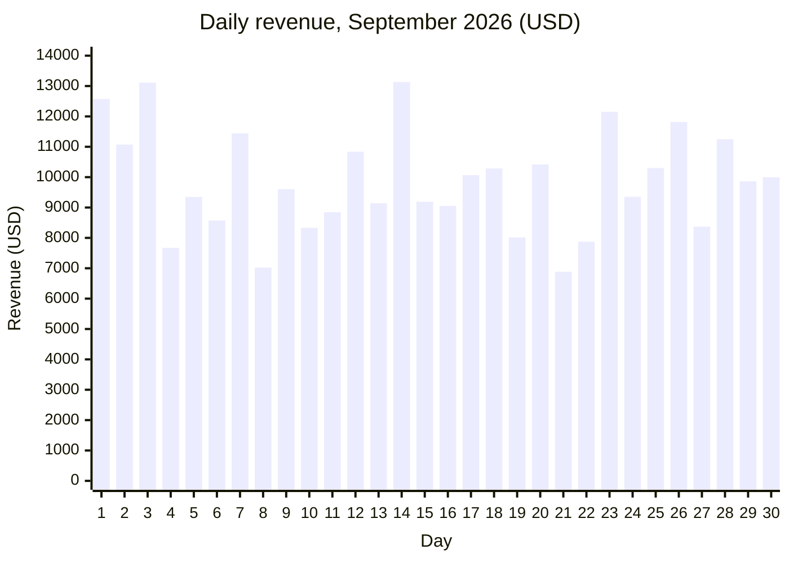
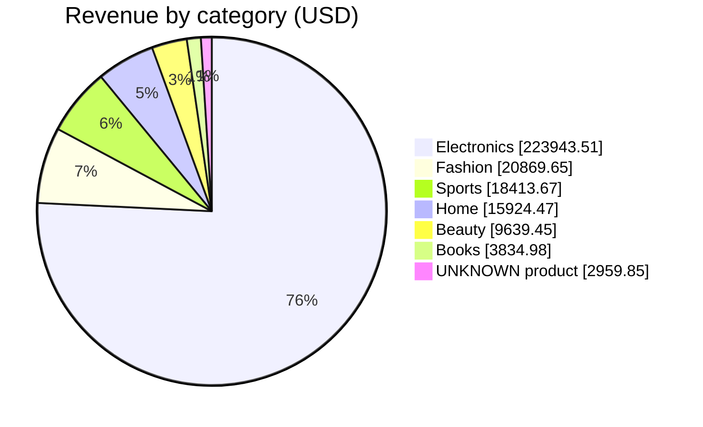
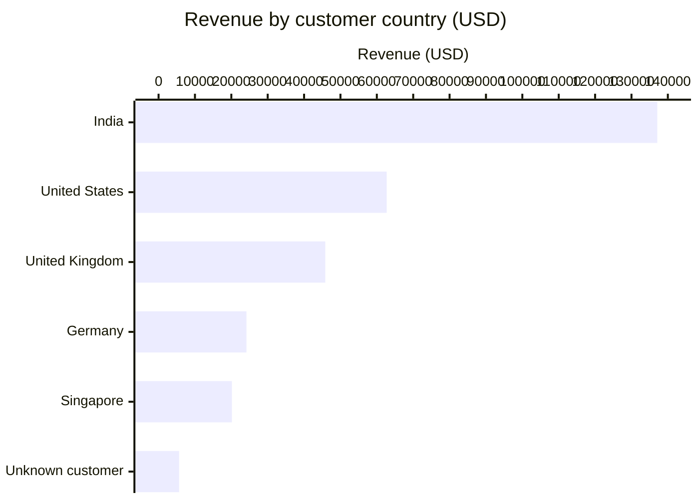
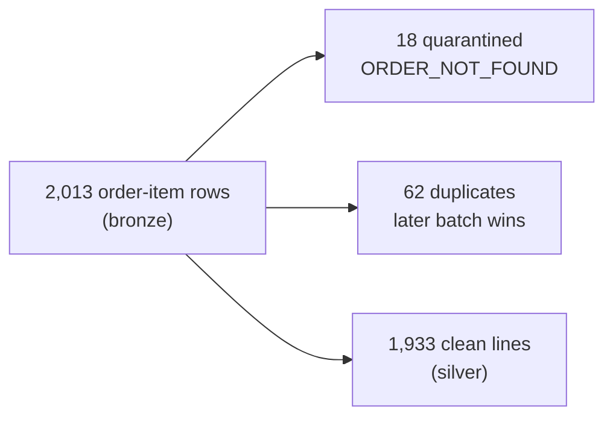

<div align="center">

# 🛒 NovaCart Order Analytics

**A medallion data pipeline that turns messy, multi-batch e-commerce files into one trusted revenue number.**


**September revenue: `$295,585.58` · 945 orders · 1,933 order lines · rerun-safe · 5/5 quality checks passing**

[Problem](#-the-problem) · [Architecture](#%EF%B8%8F-architecture) · [Workflow](#-how-a-batch-flows-through-the-pipeline) · [Insights](#-business-insights) · [Reliability](#%EF%B8%8F-reliability-evidence) · [Run it](#-quick-start)

</div>

---

## 📌 The problem

NovaCart's finance team was getting **different September revenue numbers from different spreadsheets**. The raw data shows why:

| What the data looks like | Why it breaks a simple report |
|---|---|
| Orders arrive as a **log of status changes**: 1,418 rows hold only 495 orders | Counting rows overstates revenue |
| Data arrives in **two batches**, and batch 2 corrects batch 1 | "Load the newest file" is not enough |
| Batch 2 even re-sends **10 versions older** than ones already loaded | A cancelled order can come back as *paid* |
| Timestamps come in **3 formats** (`Z`, `+05:30`, `dd/MM/yyyy HH:mm`) | Orders land on the wrong day |
| Currency is **blank (194 rows) or lower-case (145 rows)** | Amounts can't be converted |
| FX rates exist **only on business days** | Weekend orders have no rate |
| Customers **change tier and country** mid-month | Reports use today's value, not the true one |
| **18 lines** for orders that don't exist, **14 lines** with unknown products, **5 payments** for missing orders | Rows get dropped silently or totals are wrong |

**Goal:** one automated pipeline that keeps the latest correct version of every order, converts everything to USD with the right day's rate, never loses a row silently, and gives **exactly the same answer when re-run**.

---

## 🏗️ Architecture



| Layer | Purpose | Tables | Load pattern |
|---|---|---|---|
| 🥉 **Bronze** | Exact copy of what arrived, for replay and audit | `orders`, `order_items`, `customers`, `products`, `fx_rates`, `payments` | Batch files: replace this batch's rows · Snapshots: overwrite |
| 🥈 **Silver** | Clean, typed, one row per business key | `orders` (MERGE), `order_items`, `dim_customer` (SCD2), `products`, `fx_rates`, `payments` | `orders` incremental; others rebuilt |
| 🚫 **Quarantine** | Bad rows kept with original values, reason and time | `orders`, `order_items`, `customers`, `payments`, `products`, `fx_rates` | Rebuilt / per batch |
| 🥇 **Gold** | Business-ready answers | `fact_order_line`, `daily_revenue`, `revenue_by_category`, `top10_customers`, `payment_mismatches` | Rebuilt from silver |
| ✅ **DQ** | Proof that every rule ran | `dq_report`, `job_runs`, `pipeline_failures` | Per batch and stage |

---

## 🔄 How a batch flows through the pipeline

The pipeline runs as a **job** with one parameter (`batch_id`), five tasks in order, **2 retries per task**, a failure path, and only one run at a time.



### The one rule that makes it correct

```sql
MERGE INTO silver.orders AS t
USING staged_orders AS s           -- newest row per order inside this batch
ON t.order_id = s.order_id
WHEN MATCHED AND s.updated_at > t.updated_at THEN UPDATE SET *   -- only newer wins
WHEN NOT MATCHED THEN INSERT *
```

This single condition handles three problems at once:



| Run | Inserted | Updated | Left untouched | `silver.orders` rows |
|---|---:|---:|---:|---:|
| batch_1 | 495 | 0 | 0 | 495 |
| batch_2 | 450 | 137 | **10 late older versions** | 945 |
| batch_2 again | 0 | 0 | 597 | **945 (no change)** |

### Gold: join 4 things → calculate 3 things

```mermaid
flowchart LR
    L["Order line"] --> J1["① + order<br/>status, currency, time"]
    J1 --> J2["② + FX rate<br/>order date, else latest earlier"]
    J2 --> J3["③ + customer version<br/>valid at order time"]
    J3 --> J4["④ + product<br/>category or UNKNOWN"]
    J4 --> C1["net_local = qty × price × (1 − discount/100)"]
    C1 --> C2["net_usd = net_local × fx_rate"]
    C2 --> C3["is_revenue = status ∈ paid, shipped, delivered"]
    C3 --> F["gold.fact_order_line"]
```



---

## 📈 Business insights

> All figures are September 2026 after both batches. Revenue counts only **paid, shipped and delivered** orders, converted to USD.

### Daily revenue (USD)



Average **~$9,850 per day**. Best days: 14 Sep ($13,135) and 3 Sep ($13,112). Returns are included as negative amounts on their order's date.

### Revenue by category



| Category | Revenue (USD) | Share |
|---|---:|---:|
| Electronics | 223,943.51 | 75.8% |
| Fashion | 20,869.65 | 7.1% |
| Sports | 18,413.67 | 6.2% |
| Home | 15,924.47 | 5.4% |
| Beauty | 9,639.45 | 3.3% |
| Books | 3,834.98 | 1.3% |
| UNKNOWN (product not in catalogue) | 2,959.85 | 1.0% |
| **Total** | **295,585.58** | **100%** |

### Revenue by customer country (at the time of the order)



### Top 5 customers

| Rank | Customer | Current tier | Revenue (USD) |
|---:|---|---|---:|
| 1 | C0035 | Silver | 20,337.77 |
| 2 | C0091 | Bronze | 18,499.49 |
| 3 | C0027 | Platinum | 17,524.83 |
| 4 | C0066 | Gold | 17,071.91 |
| 5 | C0058 | Silver | 16,855.55 |

### 🔍 Key takeaways

- **Electronics drives the business.** It is about 76% of revenue, so any pricing or stock issue there moves the whole month.
- **India is the largest market** at 46% of revenue, followed by the US (21%) and the UK (16%).
- **Most orders complete.** Of 945 orders, 666 are delivered and 107 (11%) are cancelled. Cancelled and placed orders are excluded from revenue automatically.
- **14 delivered orders have payment problems.** For example, NC-100090 (₹44,534.76) has no payment, and NC-100279 was **paid exactly double**. Finance should review these.
- **Data issues are visible, not hidden.** 18 orphan lines and 5 orphan payments sit in quarantine, and 14 lines with unknown products are still counted under `UNKNOWN`.

---

## 🧹 Data quality: nothing is dropped silently

Every input row ends up in exactly one place: loaded, quarantined with a reason, or counted as a duplicate or older version.



| Entity | Input rows | Quarantined | Duplicates / older | Loaded |
|---|---:|---:|---:|---:|
| Orders (batch 2) | 1,545 | 0 | 948 older or duplicate versions | 597 → MERGE |
| Order items | 2,013 | 18 (order not found) | 62 | 1,933 |
| Customers | 194 | 5 (no `updated_at`) | 4 exact + 19 no-change | 166 versions + 1 unknown |
| Payments | 1,164 | 5 (order not found) | 0 | 1,159 |

**The gate.** The run **fails** if any of these breaks:

| # | Check | Status |
|---|---|:---:|
| 1 | One row per order in `silver.orders` | ✅ |
| 2 | This batch landed in bronze exactly once | ✅ |
| 3 | One fact row per order line | ✅ |
| 4 | Exactly one current version per customer | ✅ |
| 5 | Daily revenue total = category revenue total | ✅ |

---

## 🛡️ Reliability evidence

| Capability | How it's shown | Result |
|---|---|---|
| **Change history** | Transaction log on `silver.orders` | MERGE 495/0 → 450/137 → **0/0 on rerun** |
| **Time travel** | Read the table as of an earlier version | 495 orders then, 945 now. NC-100280 was *paid*, now *delivered* |
| **Schema enforcement** | Append a row with an extra column | ❌ Rejected, row count unchanged |
| **Late data protection** | NC-100039: older *paid* version sent after *cancelled* | Stays **cancelled** |
| **Change data feed** | Row-level changes of the batch-2 MERGE | 450 inserts + 137 before/after updates |
| **Point-in-time customers** | C0004 moved India → Germany on 14 Sep | 12 Sep order → India; later orders → Germany |
| **FX fallback** | NC-100133 ordered Saturday 5 Sep | Uses Friday 4 Sep rate (434 lines used an earlier rate) |
| **Retries + failure path** | Run `batch_9` (file doesn't exist) | 3 attempts → downstream skipped → `on_failure` logged |
| **Idempotency** | Run batch_2 twice | Every table identical |

---

## 🚀 Quick start

```bash
git clone https://github.com/raj3119/novacart-order-analytics.git
cd novacart-order-analytics
python3 -m venv .venv && source .venv/bin/activate      # Windows: .venv\Scripts\activate
pip install -r requirements.txt

python tests/test_pipeline.py     # 7 acceptance tests
streamlit run app.py              # opens http://localhost:8501
```

On first start the app loads batch_1 → batch_2 → batch_2 automatically.

**Terminal alternative**

```bash
python run_pipeline.py --demo                    # reset + batch_1 + batch_2 + batch_2 again
python run_pipeline.py --batch batch_9           # failure demo: retries, then on_failure
python watch.py                                  # file-arrival trigger: runs when a new batch lands
```

### The Streamlit app

| Page | What you can do |
|---|---|
| **Overview** | Problem, architecture and headline numbers |
| **Run pipeline** | Run any batch, watch the live log, see every task attempt |
| **Gold dashboard** | Daily and category revenue, top customers, payment mismatches, with filters |
| **Data quality** | DQ report, gate status, reconciliation, quarantine tables |
| **Evidence (Delta)** | History, time travel, schema enforcement, OPTIMIZE, late version, change feed, SCD2, FX |
| **Data explorer** | Browse and download any table in any layer |
| **Handbook check** | Expected vs actual for every key number |

### Deploy (Streamlit Community Cloud, free)

1. Push this repo to GitHub.
2. Go to [share.streamlit.io](https://share.streamlit.io) → **Create app** → choose the repo, branch `main`, file `app.py` → **Deploy**.

---

## 📁 Project structure

```
novacart-order-analytics/
├── app.py                  Streamlit UI (7 pages)
├── run_pipeline.py         Command-line runner (--batch, --reset, --demo)
├── watch.py                File-arrival trigger
├── requirements.txt
├── data/input/             8 source files (never modified)
├── pipeline/
│   ├── config.py           Settings: input path, rules, retries
│   ├── lakehouse.py        Storage layer: atomic commits, history, time travel,
│   │                       MERGE, replace-per-batch, schema enforcement, change feed
│   ├── common.py           Timestamp parsing, safe casts, quarantine split, DQ report
│   ├── bronze.py           01 Land files as text + lineage
│   ├── silver_orders.py    02 Clean, quarantine, latest per order, MERGE
│   ├── silver_others.py    03 Items, payments, FX, products, customer SCD2
│   ├── gold.py             04 Fact table + 4 reports
│   ├── dq_checks.py        05 Five-check quality gate
│   ├── job.py              Orchestration: tasks, retries, on_failure, run lock
│   └── evidence.py         06 Reliability evidence
└── tests/test_pipeline.py  End-to-end acceptance tests
```

---

## 🧭 Design decisions and assumptions

| Decision | Why |
|---|---|
| Bronze stores **every value as text** | Nothing is lost when a number arrives as `"50.89"`; silver casts it safely |
| **`updated_at` decides**, never file order | Batch 2 contains older versions that must not overwrite newer ones |
| Strict **`>`** in the MERGE (not `>=`) | A rerun changes nothing and history shows no fake updates |
| Missing currency is **derived from shipping country**; a present currency is never overridden | Follows the brief; 48 orders end with a derived currency |
| `dd/MM/yyyy HH:mm` timestamps are **UTC** | Stated in the brief |
| FX: rate on the order date, **else the most recent earlier rate**; USD = 1 | Covers weekends and the missing Monday 7 Sep |
| New customer version **only when tier or country changes** | Name or email edits don't create history (19 rows skipped) |
| Customers missing from the CRM get **key −1 / UNKNOWN** | Their 39 lines still count |
| Payment mismatches use **revenue orders only** (14 rows) | A literal reading lists every cancelled and placed order (165 rows of noise). One setting in `config.py` switches it |

### How this maps to Databricks / Delta Lake

This edition runs locally on **pandas + SQLite**. The storage layer reproduces the Delta Lake behaviours the pipeline relies on. The same logic runs on **Azure Databricks with PySpark and native Delta** in the cloud version.

| Databricks + Delta | This project |
|---|---|
| Unity Catalog schemas | One SQLite file per layer, attached as `bronze`, `silver`, … |
| Delta commit + `DESCRIBE HISTORY` | Atomic transaction + `_delta_log` row with metrics |
| `VERSION AS OF` | Snapshot per version of `silver.orders` |
| `MERGE INTO … WHEN MATCHED AND …` | `Lake.merge()` with the same rule and metrics |
| `replaceWhere` | `Lake.replace_where()` |
| Schema enforcement | `Lake.append()` rejects unexpected columns |
| Change Data Feed | Insert + update pre/post images per MERGE |
| `OPTIMIZE … ZORDER BY` | Table rewritten sorted by `order_date` |
| Lakeflow Job (parameter, retries, on_failure) | `pipeline/job.py` |
| File-arrival trigger | `watch.py` |

---

<div align="center">

Built by **Team DATAVERSE** for the HCLTech Cloud Data Engineer (AI-Ready) hackathon, October 2026.

</div>
